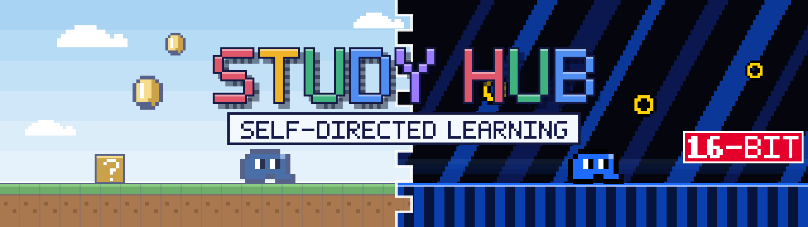

<p align="center">
  
</p>

# Study Hub

**A personal study shelf you build with an agent — and keep.**

Study Hub is a small, local, zero-dependency web app for self-directed learning. You pick something you want to understand, work through it with an AI agent, and the agent turns that conversation into a proper interactive lesson: explanations, diagrams, live demos and checks for understanding. The lesson lands on your shelf, where it stays ready to reopen whenever you want to revisit it.

It's built around a simple loop:

1. **Ask.** Bring a topic, a half-formed question, or something you keep meaning to learn.
2. **Build together.** The agent researches it, explains it, and writes it up as an interactive lesson shaped around how *you* learn, not a generic tutorial.
3. **Keep.** The lesson is saved into the hub, organised by subject, with created and updated dates so you can see how fresh it is.
4. **Return.** Come back to read and replay the demos. The hub remembers what you've read and where you left off, and shows what's new and what's planned next.

There's no account, no database and no build step. The lessons are plain HTML, CSS and JavaScript files in this folder, so they're easy for an agent to write and easy for you to own.

## Where things live

```
index.html        the hub shell (sidebar + page frame)
server.js         zero-dependency dev server with hot reload
shared/           theme, dark skin, and the scripts every page shares
sections/         one folder per section: its manifest, home page and its lessons/courses
docs/             structure and conventions
assets/ scripts/  README banner and the script that generates it
```

## Run it

You need [Node.js](https://nodejs.org) 18 or newer.

```bash
npm run dev
```

Then open <http://localhost:4777/>. On macOS you can also double-click **`Start Study Hub.command`**.

The dev server hot-reloads as files change, so you can watch a lesson take shape while the agent writes it. Your reading progress is saved locally in `.hub-data/` and is not committed.

## Adding to the shelf

Lessons are created in conversation with an agent. [`docs/HUB-STRUCTURE.md`](docs/HUB-STRUCTURE.md) describes how sections, manifests, dating, stubs and read-tracking fit together, and it's the file to point an agent at before it adds or edits content.

## Look and feel

The hub is a study tool, not a game. The retro styling is only there to make it a pleasant place to come back to. The current skin is a bright, sky-blue pixel-art look with chunky borders and dialog-style callouts. It's the "light" half of the banner above. The right half previews a "dark" counterpart inspired by 16-bit Sega-era styling: black fields, bold cobalt blue and a checkerboard floor. It's dark because that branding was, not because it's a night mode, and it sits alongside the light skin as a light/dark pair, switchable with the LIGHT/DARK toggle in the top bar. The design system lives in [`shared/theme.css`](shared/theme.css) (the dark skin is `shared/theme-sega.css`), and the banner is generated by [`scripts/make-banner.mjs`](scripts/make-banner.mjs).
